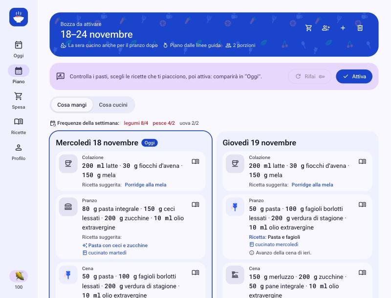
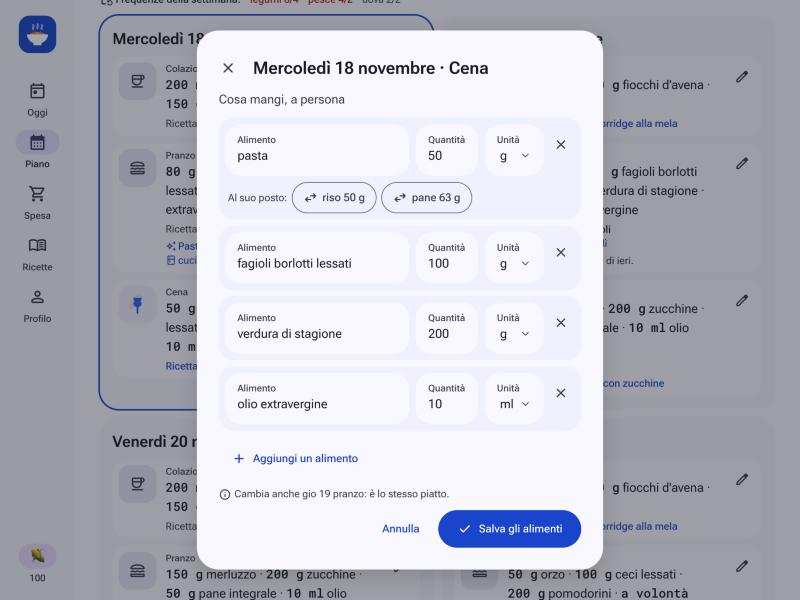
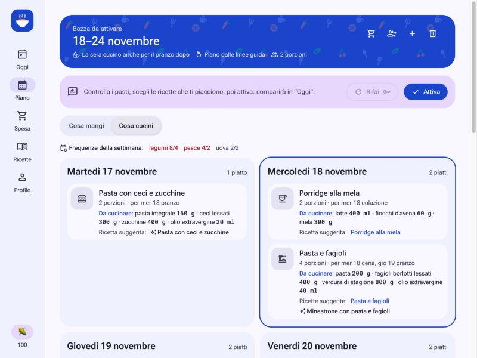

# Languorino

Cosa mangio questa settimana? Languorino parte dal profilo (gusti, allergie,
obiettivi, stile di vita, anche raccontati a voce in un'intervista), parte dal
piano alimentare (del nutrizionista o scritto dalle linee guida) e prepara le
settimane per ingredienti con il meal prep, con le ricette suggerite; tiene
il ricettario di casa (anche dalle foto delle ricette scritte a mano),
calcola la spesa e, dalla foto del frigo, dice cosa cucinare oggi. Alla chat
"Chiedi a Languorino" si chiede quanto mangiare a pranzo e cena o cosa dice il
piano del nutrizionista. Cosa fa in [docs/specifica.md](docs/specifica.md), come è
progettata in [docs/progettazione.md](docs/progettazione.md).

## Come si usa

1. **Piano alimentare** (Piano → "Il tuo piano alimentare"): carica il piano
   del nutrizionista in PDF o foto, oppure "Dalle linee guida" e lo scrive
   l'AI dal profilo. Si controllano opzioni, grammature e frequenze e si
   conferma.
2. **Nuova preparazione**: giorni, pasti, porzioni, meal prep. Ogni pasto
   arriva come alimenti e quantità a persona; sotto, le ricette suggerite e le
   frequenze della settimana ("legumi 3/3").

   

3. **Cambia un alimento** se non ti torna (matita del pasto; il libro accanto
   è per la ricetta): sotto ogni alimento ci sono gli altri della stessa voce
   del piano ("Pesce bianco: merluzzo, sogliola, orata") e le sostituzioni, con
   la grammatura già fatta, e il cambio vale anche per il pranzo-avanzo. La
   stessa proteina sta al massimo in 2 piatti a settimana. Gli alimenti di colazione e merenda (yogurt, frutta secca)
   non finiscono mai a pranzo e cena.

   

4. **Scegli la ricetta**: tocca quella che cucini (vale anche per il
   pranzo-avanzo), o fai scrivere un'idea. "Cosa cucini" somma le porzioni
   per giorno di cottura.

   

5. **Spesa**: dagli alimenti del piano e, per le ricette approvate, i loro
   ingredienti in più. In **Ricorrenti** (`/spesa/ricorrenti`) scegli le cose
   che compri sempre, anche se non sono nei pasti preparati: la colazione tolta
   dal piano, le merende, il caffè. Te le propongo dal piano alimentare, con le
   grammature e le volte a settimana, e le aggiungo a ogni lista
   ([ADR 0024](docs/decisions/0024-ricorrenti-della-spesa.md)).

Stack: Django + DRF + Postgres + Celery/Redis + React (Vite, TypeScript) +
Tailwind con token Material 3, tutto in Docker Compose
([ADR 0001](docs/decisions/0001-stack.md)).

---

## Avvio

```bash
cp .env.example .env && docker compose up --build
```

| | |
|---|---|
| App | http://localhost:5177 |
| API | http://localhost:8030/api |
| Docs OpenAPI | http://localhost:8030/api/docs/ |
| Admin Django | http://localhost:8030/admin/ |

Le porte sono diverse dagli altri progetti per farli girare insieme; per lo
stesso motivo il cookie di refresh si chiama `languorino_refresh`.

Per entrare serve cornhub in locale (repo cornhub, `http://localhost:8095`):
login e AI passano da lì ([ADR 0021](docs/decisions/0021-account-e-ai-tramite-cornhub.md)).
Registra l'app su cornhub con `manage.py register_app languorino` (comando
completo in `.env.example`) e copia client id, secret e token in `.env`.
Le mail finiscono nei log del worker: `docker compose logs -f worker`. Il codice è montato come volume (hot reload);
dopo nuove dipendenze ricostruisci l'immagine: `docker compose build backend`.

---

## Fondamenta

- **Account unico su cornhub** ([ADR 0021](docs/decisions/0021-account-e-ai-tramite-cornhub.md)):
  registrazione, login, password ed email stanno su cornhub (OpenID Connect,
  `apps/users/sso.py`); gli account di prima si agganciano alla prima entrata
  per email verificata. Poi la sessione è quella dell'app: access token (15
  min) in memoria, refresh (14 giorni) in cookie `httpOnly` su `/api/auth`,
  blacklist al logout, stato dell'account chiesto a cornhub a ogni refresh.
  `manage.py export_cornhub_users` esporta gli utenti per il passaggio. Rate
  limit su login (`THROTTLE_AUTH`) e sulle chiamate all'AI (`THROTTLE_AI`).
- **AI tramite cornhub**: niente chiavi né tetti in Languorino. Funzioni
  piccole sulla chiave di casa (quota in pannocchie), grandi sulla chiave
  dell'utente nei suoi limiti; accanto ai loro bottoni `<AiCost>` dice chi
  paga e quanto. Chiave mancante o limite raggiunto fermano il lavoro con il
  messaggio e il link a cornhub.
- **Mail** dal worker Celery dopo il commit, con retry, testo + HTML su un solo
  layout (`backend/templates/emails/`). In produzione SMTP di **Brevo**, lo
  stesso account di tutti i progetti (mittente `messagg@inoo.it`).
- **File caricati**: via `/media` si servono solo le immagini (ricette, avatar).
  PDF dei ricettari (`books/`) e file dei lavori (`jobs/`, anche i piani del
  nutrizionista) non si scaricano mai: 404 da Caddy in produzione e da Django in
  sviluppo (`PRIVATE_MEDIA_PREFIXES`, `apps/core/media.py`).
- **Errori**: con `SENTRY_DSN` impostato le eccezioni non gestite di richieste
  e task Celery (worker, worker-ai, beat) vanno a GlitchTip via `sentry-sdk`
  (`config/sentry.py`), senza dati personali, corpo delle richieste né variabili
  locali; `SENTRY_ENVIRONMENT` di default `production`. Vuoto = spento; nei test
  non parte mai. Il frontend usa `@sentry/react` con `VITE_SENTRY_DSN`, letta
  alla build (variabile `SENTRY_DSN_FRONTEND` del repo su GitHub).
- **Soft delete + audit**: `BaseModel` (UUID, `deleted_at`) e `django-simple-history`.
- **Material 3**: ruoli M3 mappati in Tailwind, Roboto Flex, Roboto Mono per i
  numeri, Material Symbols Rounded. Rail su desktop, bottom bar e FAB sotto i
  768px, dialog di conferma M3 (`useConfirm()`), niente `window.confirm`.
  La palette va rigenerata dal colore seed del progetto (`frontend/src/index.css`).
- **i18n**: italiano sorgente, inglese in `backend/locale/en/LC_MESSAGES/`,
  frontend e backend sullo stesso catalogo gettext. Il nome dell'app sta in
  `settings.APP_NAME`, fuori dalle stringhe tradotte.
- **LLM** ([ADR 0005](docs/decisions/0005-llm-e-lavori-lunghi.md), [0021](docs/decisions/0021-account-e-ai-tramite-cornhub.md)):
  tutto passa da `apps/ai/client.py` verso il gateway di cornhub
  (`CORNHUB_APP_TOKEN`; vuoto = funzioni spente), che sceglie modelli e
  riserve. Le chiamate girano sulla coda Celery `ai` (servizio `worker-ai`);
  log con `docker compose logs -f worker-ai`.

---

## Struttura

```
backend/
├── config/settings/     base · dev · prod · test
├── templates/emails/    layout unico delle mail
└── apps/
    ├── core/            BaseModel, methods (token, hash, mail), i18n, task mail, client di cornhub (cornhub.py), stima AI (ai_views.py)
    ├── users/           User custom, login con cornhub (sso.py), sessione JWT, export verso cornhub
    ├── profiles/        profilo alimentare, gusti e allergie (14 allergeni UE), intervista (interview.py) e voce in tempo reale (live.py)
    ├── recipes/         ricette, tag, catalogo ingredienti (catalog.py), riconoscimento dei nomi, immagini (images.py),
    │                    import da foto (importing.py), calorie e macro (nutrition.py), ricettari PDF letti a pezzi (books.py, tasks.py), condivisione (sharing.py)
    ├── ai/              adattatore verso il gateway AI di cornhub (eccezioni di sempre)
    ├── jobs/            lavori lunghi su Celery (coda "ai"): file, stato, bozza, conferma
    ├── plans/           preparazione: calendario del prep (schedule.py), settimane per ingredienti (generation.py), ricette suggerite (suggestions.py),
    │                    piano alimentare letto da PDF/foto (nutritionist.py) o dalle linee guida (guidelines.py), chat su profilo e piano (ask.py), piano condiviso in sola lettura (sharing.py)
    ├── community/       ricette pubbliche: profili /u/<handle> (profiles.py), voti, commenti con foto (ADR 0017)
    ├── shopping/        lista della spesa: somme e conversioni dal piano (aggregate.py), ricalcolo, ricorrenti suggeriti dal piano alimentare (recurring.py)
    └── kitchen/         cosa cucino oggi: foto del frigo, ricette che si possono fare, idee nuove (cook_today.py), pulizia delle idee mai salvate
frontend/src/
├── api/hooks.ts         hook TanStack Query, una sezione per area
├── lib/                 client HTTP, auth, i18n, format, tipi
├── components/          UI M3, layout, dialog di conferma
└── features/            auth · account · home · onboarding · profile · interview · ask · recipes · plans · shopping · kitchen
deploy/                  compose di produzione e Caddy interno (edge e offsite: repo homeserver)
docs/decisions/          ADR (modello in 0000-modello.md)
```

### API

| | |
|---|---|
| `GET /api/auth/sso/start?next=` · `GET /api/auth/sso/callback` | login con cornhub (OIDC + PKCE), poi la sessione dell'app |
| `POST /api/auth/refresh` · `logout` | sessione (refresh nel cookie); il logout risponde `{logout_url}` di cornhub |
| `GET /api/auth/config` | `{login_url, account_url, ai_url, register_url}`: dove stanno login e account su cornhub |
| `GET/PATCH /api/me` | account nell'app (indirizzo pubblico, lingua); nome ed email in sola lettura |
| `GET /api/ai/quote?features=plan_week:4,…` | chi paga e quanto costa una funzione AI, chiesto a cornhub per l'utente |
| `GET/PATCH /api/profile` · `POST /api/profile/complete` | profilo alimentare e fine del wizard |
| `GET/POST /api/profile/preferences` · `DELETE …/{id}` | gusti, antipatie, allergie, intolleranze |
| `POST /api/profile/interview` (JSON o multipart `messages`, `audio`) | un turno dell'intervista, anche a voce: job con risposta e proposte da confermare ([ADR 0013](docs/decisions/0013-intervista-e-voce.md)) |
| `POST /api/profile/interview/live` · `POST …/interview/proposal` `{name, args}` | conversazione a voce in tempo reale con Gemini Live: token monouso vincolato, creato da cornhub · pulizia di quello che Gemini segna ([ADR 0014](docs/decisions/0014-modello-veloce-e-voce-in-tempo-reale.md)) |
| `GET /api/ingredients?q=` | suggerimenti dal catalogo (e dagli ingredienti propri) |
| `GET/POST /api/recipes` (`?q=`, `?tag=`, `?slot=`, `?max_minutes=`, `?difficulty=`, `?in_cookbook=`) · `GET/PATCH/DELETE …/{id}` | ricettario, con allergeni e avvisi dal profilo |
| `GET /api/tags` · `DELETE /api/tags/{id}` | tag con il numero di ricette |
| `GET/POST /api/jobs` (multipart `kind`, `files`) · `GET/DELETE /api/jobs/{id}` | lavori lunghi: import di ricette da foto e PDF |
| `POST /api/jobs/{id}/retry` · `POST /api/jobs/{id}/confirm` `{recipes}` | riprova un lavoro non riuscito · le bozze riviste diventano ricette |
| `GET/POST /api/recipe-books` (multipart `file`) · `GET/PATCH/DELETE …/{id}` · `POST …/{id}/retry` | ricettari PDF letti a pezzi ([ADR 0006](docs/decisions/0006-ricettari-pdf.md)); le ricette con `GET /api/recipes?book={id}` |
| `POST/DELETE /api/recipes/{id}/image` (multipart `file`) · `POST …/image/draw` | foto vera della ricetta o disegno dell'AI in un job ([ADR 0011](docs/decisions/0011-immagini-delle-ricette.md)) |
| `POST/DELETE /api/recipes/{id}/share` · `GET /api/shared/recipes/{token}` · `POST …/copy` | link di condivisione `/r/<token>`, pagina pubblica senza login, copia nel proprio ricettario ([ADR 0012](docs/decisions/0012-condivisione-delle-ricette.md)) |
| `POST /api/recipes/{id}/share` `{visibility, renew?}` · `GET /api/public/profiles/{handle}` | visibilità privata, con il link o pubblica; profilo pubblico `/u/<handle>` con le ricette pubbliche ([ADR 0017](docs/decisions/0017-ricette-pubbliche-voti-e-commenti.md)) |
| `PUT/DELETE /api/shared/recipes/{token}/rating` `{stars}` · `GET/POST …/comments` (multipart `text`, `parent`, `images`) · `DELETE /api/comments/{id}` | voti da 1 a 5 stelle, commenti con risposte e foto |
| `POST /api/recipes/{id}/nutrition` | calorie e macro a porzione stimati dall'AI dagli ingredienti, in un job ([ADR 0018](docs/decisions/0018-calorie-e-macro-delle-ricette.md)); si leggono anche dalla ricetta importata o si scrivono a mano |
| `POST /api/recipe-books/{id}/images` | foto delle ricette ritagliate dal PDF e illustrazioni AI per le altre; parte anche da sola a fine lettura ([ADR 0015](docs/decisions/0015-immagini-dei-ricettari-pdf.md)) |
| `POST /api/recipe-books/{id}/reread` | rilegge il PDF e aggiorna quantità e passaggi delle ricette che ci sono già, senza rifare le immagini ([ADR 0022](docs/decisions/0022-rilettura-dei-ricettari.md)) |
| `POST /api/recipes/{id}/save` | una ricetta di un ricettario PDF, del piano o di "cosa cucino oggi" entra nel proprio ricettario |
| `GET/POST /api/plans` · `GET /api/plans/current` · `GET/DELETE /api/plans/{id}` | preparazione ([ADR 0007](docs/decisions/0007-piano-alimentare.md), [0023](docs/decisions/0023-piano-e-preparazione-per-ingredienti.md)): si genera una settimana alla volta; `nutritionist_plan` obbligatorio |
| `POST /api/plans/{id}/activate` · `regenerate` · `retry` · `PATCH …/meals/{meal_id}` | attiva, rifai, riprendi, cambia un pasto. Ogni pasto ha `components` (alimenti a persona), `suggestions` (ricette suggerite o idee), `portion`; `recipe_id` approva una ricetta per tutto il piatto; `components` cambia gli alimenti di tutto il piatto (toglie suggerimenti e ricetta se cambia un nome, rifiuta allergie e alimenti da evitare) |
| `GET /api/plans/{id}/meals/{meal_id}/swaps` | per ogni alimento del pasto gli equivalenti delle sostituzioni del piano, con la grammatura in proporzione |
| `POST /api/plans/{id}/meals/{meal_id}/suggestions/{index}/write` | scrive per intero un'idea suggerita (job `meal_recipe`), che prende il posto dell'idea |
| `POST /api/plans/{id}/meals/{meal_id}/ideas` `{hint}` | due ricette nuove per quel pasto, scritte dall'AI in un job, da scegliere con il PATCH |
| `GET/POST /api/nutritionist-plans` (multipart `files`) · `GET/PATCH/DELETE …/{id}` · `POST …/{id}/confirm` · `POST …/{id}/reread` | piano alimentare del nutrizionista: lettura in un job, revisione, conferma ([ADR 0010](docs/decisions/0010-piano-del-nutrizionista.md)); si usa con `nutritionist_plan` in `POST /api/plans` |
| `POST /api/nutritionist-plans/guidelines` | piano alimentare dalle linee guida CREA/OMS e dal profilo (job `guidelines_plan`), da rivedere come l'altro ([ADR 0023](docs/decisions/0023-piano-e-preparazione-per-ingredienti.md)) |
| `GET/POST /api/plan-shares` `{email}` · `DELETE …/{id}` · `GET …/{id}/plan` · `GET …/{id}/recipes/{recipe_id}` | piano fatto vedere a un altro account, in sola lettura ([ADR 0019](docs/decisions/0019-piano-condiviso-in-sola-lettura.md)) |
| `POST /api/ask` `{messages}` | una domanda alla chat "Chiedi a Languorino": job con la risposta da profilo, piano e piano del nutrizionista ([ADR 0016](docs/decisions/0016-chiedi-a-languorino.md)) |
| `GET/POST /api/shopping` · `GET/PATCH/DELETE …/{id}` · `POST …/{id}/regenerate` | liste della spesa dal piano o a mano ([ADR 0008](docs/decisions/0008-lista-della-spesa.md)) |
| `POST /api/shopping/{id}/items` · `PATCH/DELETE …/items/{item_id}` | voci a mano, spunta, "ce l'ho già", modifica |
| `GET/POST /api/shopping/recurring` · `PATCH/DELETE …/{id}` · `GET …/suggestions` | ricorrenti della spesa e suggerimenti dai pasti non preparati ([ADR 0024](docs/decisions/0024-ricorrenti-della-spesa.md)) |
| `POST /api/cook-today/scan` (multipart `files`) | foto del frigo → job con gli alimenti riconosciuti ([ADR 0009](docs/decisions/0009-cosa-cucino-oggi.md)) |
| `POST /api/cook-today/suggest` | ricette che si possono fare con quegli ingredienti e job con due idee nuove |
| `GET /api/i18n/catalog` · `POST /api/i18n/language` | traduzioni del frontend e lingua scelta |
| `GET /api/health` | healthcheck del container |

---

## Comandi

```bash
docker compose run --rm -e DJANGO_SETTINGS_MODULE=config.settings.test backend pytest
```

```bash
docker compose run --rm --no-deps backend ruff check apps config
```

```bash
docker compose run --rm --no-deps frontend sh -c "npx tsc -b && npx eslint src --ext .ts,.tsx"
```

```bash
docker compose run --rm --no-deps backend python manage.py createsuperuser
```

Dopo una modifica a `backend/apps/recipes/catalog.py`:

```bash
docker compose exec backend python manage.py load_catalog
```

Traduzioni: estrai, traduci in `backend/locale/en/LC_MESSAGES/*.po`, ricompila
e committa `.po` e `.mo`.

```bash
docker compose run --rm --no-deps backend python manage.py makemessages -l en -i staticfiles --no-obsolete
```

```bash
docker compose run --rm --no-deps frontend npm run i18n:js
```

```bash
docker compose run --rm --no-deps -v "$PWD/frontend/.i18n:/i18n:ro" -w /i18n backend python /app/manage.py makemessages -d djangojs -l en -e js --no-location --no-obsolete
```

```bash
docker compose run --rm --no-deps backend python manage.py compilemessages -l en
```

---

## Deploy (produzione)

**https://languor.inoo.it**, sul homeserver accanto agli altri progetti. Push
sul branch `prod` → la GitHub Action (`.github/workflows/prod.yml`) fa ruff,
pytest, tsc ed eslint e pubblica `languorino-backend:prod` e
`languorino-web:prod` su ghcr.io → Watchtower (quello di cinemino) ricrea i
container. Le migrazioni girano all'avvio del backend. Watchtower aggiorna le
immagini ma non aggiunge servizi né reti: quando cambia
`deploy/compose.prod.yaml` va ricopiato a mano in `~/languorino` e poi
`docker compose -f compose.prod.yaml up -d`.

Il Caddyfile interno invece sta dentro l'immagine `languorino-web`: si aggiorna
col deploy, non va ricopiato. Nel compose ogni servizio ha
`no-new-privileges` e un tetto di memoria (`mem_limit`); backend, worker,
worker-ai e beat girano anche senza capability (`cap_drop: [ALL]`).

Primo avvio sul server:

1. DNS: record A per `languor.inoo.it` → l'IP del server (come gli altri progetti);
2. `~/languorino/compose.prod.yaml` (da `deploy/`) e `~/languorino/.env`
   (modello `deploy/.env.prod.example`, SMTP Brevo come gli altri, `CORNHUB_*`
   da `register_app languorino` sul server di cornhub). Backend, worker e beat
   stanno anche sulla rete esterna `cornhub`, creata dal compose di cornhub;
3. il blocco `languor.inoo.it { reverse_proxy languorino-web:80 }` nel Caddyfile
   dell'edge, che sta nel repo [homeserver](https://github.com/ImBiagio/homeserver)
   (`edge/`), applicato con `./deploy.sh edge` (valida, fa il backup e
   ricarica senza fermare gli altri siti);
4. `git push origin main:prod`, poi `cd ~/languorino && docker compose -f
   compose.prod.yaml up -d` e `createsuperuser`.

Backup notturni sul disco del server, a ogni avvio e poi ogni notte:
Postgres (servizio `backup`) in `~/languorino/backups/{daily,weekly,monthly,last}`
e i file caricati (servizio `media-backup`, volume `languorino_media`) in
`~/languorino/backups/media/`. La copia cifrata fuori dal server, ogni notte su
Google Drive, la fa lo stack `~/offsite` del repo homeserver (`offsite/`).

## Test

Backend con `pytest` + `factory-boy`: login con cornhub finto (id_token
firmati nel test, aggancio per email verificata, stato dell'account al
refresh), adattatore AI e traduzione degli errori di cornhub, export degli
utenti, catalogo delle traduzioni e scelta della lingua, e le funzioni
dell'app con l'AI finta.
