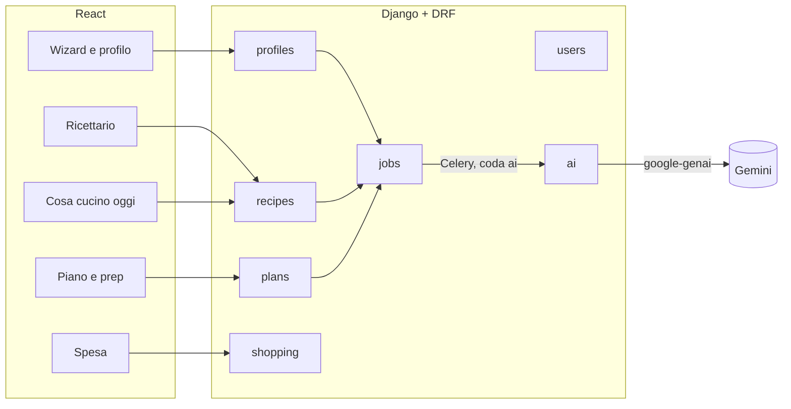
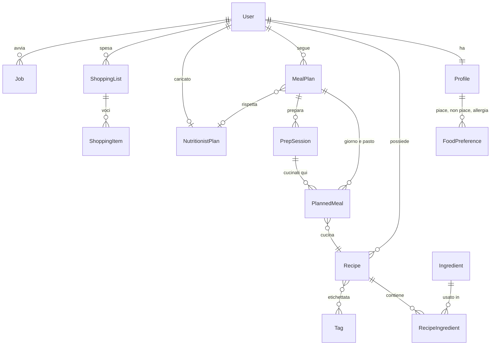
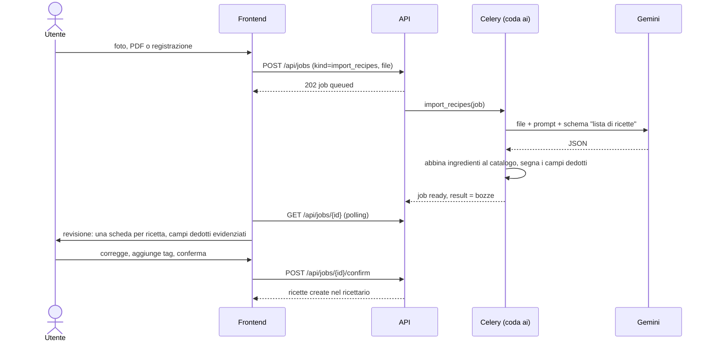

# Languorino — progettazione

Come costruire quello che descrive [specifica.md](specifica.md): moduli,
modello dati, flussi con l'LLM, API, schermate e ordine di sviluppo. È una
proposta: ogni scelta strutturale, quando la confermiamo, diventa un ADR in
`docs/decisions/`.

---

## 1. Principi

Cinque regole che reggono tutto il resto.

1. **L'LLM propone, l'utente conferma.** Ogni cosa che l'LLM produce (ricetta
   importata, piano del nutrizionista, profilo dall'intervista, piano generato)
   nasce come **bozza**. Nei dati veri entra solo dopo un tocco su "Conferma".
   Nel modello è un campo `status` (`draft` → `confirmed`), non una tabella a
   parte.
2. **Le regole di sicurezza stanno nel codice, non nel prompt.** Allergie e
   intolleranze filtrano le ricette **prima** di chiamare l'LLM e ricontrollano
   il risultato **dopo**. Il prompt le ripete, ma non è lui a garantirle.
3. **Tutto ciò che chiama l'LLM gira in Celery.** Un import o un piano di un
   mese possono metterci decine di secondi. La richiesta HTTP crea un **job**,
   risponde subito e il frontend segue lo stato del job. È lo stesso schema
   già usato per le mail.
4. **All'LLM vanno solo i dati che servono.** Niente nome, email o data di
   nascita: età, sesso, peso, obiettivi e vincoli sì. Patologie e peso sono dati
   sanitari: stanno solo nel nostro Postgres e spariscono con l'account.
5. **Un solo punto di accesso a Gemini.** Prompt, schemi JSON, retry, timeout,
   rate limit e registro dei costi stanno in un'app `ai`. Le altre app chiamano
   funzioni con nomi di dominio (`read_recipes(files)`, `plan_week(...)`), mai
   l'API direttamente.

---

## 2. Moduli

| App Django | Cosa contiene |
|---|---|
| `users` | c'è già: account, auth, lingua |
| `profiles` | profilo alimentare: dati fisici, obiettivi, stile di vita, preferenze, allergie |
| `recipes` | ricette, ingredienti, tag, immagini, condivisione |
| `plans` | piano alimentare, pasti, sessioni di prep, piano del nutrizionista |
| `shopping` | liste della spesa e generazione dal piano |
| `jobs` | i lavori lunghi: import, generazioni, con stato, file in ingresso e bozza in uscita |
| `ai` | client Gemini, prompt, schemi, registro delle chiamate |

---

## 3. Modello dati

Tutti i modelli ereditano `BaseModel` di `core` (UUID, `deleted_at`, storico).

### profiles

**Profile** (1:1 con `User`)

| Campo | Note |
|---|---|
| `first_name`, `last_name` | il nome visibile resta `User.display_name` |
| `birth_date` | l'età si calcola, non si salva |
| `sex` | `f` / `m` / `other`, serve alle stime di fabbisogno |
| `height_cm`, `weight_kg` | decimali |
| `goals` | lista di scelte (`lose_weight`, `gain_muscle`, `more_protein`, `eat_better`, `save_time`…) più `goals_note` libero |
| `activity_level` | sedentario / leggero / moderato / intenso |
| `sport_sessions_per_week` | intero |
| `conditions` | patologie, lista di testi liberi |
| `followed_by_nutritionist` | bool: decide il ramo del piano |
| `meal_slots` | pasti del giorno di default (`breakfast`, `lunch`, `dinner`, `snack`) |
| `household_size` | per quante persone si cucina di solito: moltiplica porzioni e spesa |
| `onboarding_completed_at` | finché è vuoto l'app apre il wizard |

**FoodPreference**: `profile`, `kind` (`like`, `dislike`, `allergy`,
`intolerance`), `label` scritto dall'utente, `ingredient` (FK facoltativa,
quando l'etichetta corrisponde a un ingrediente noto), `allergen` (uno dei 14
allergeni UE, facoltativo).

Allergie e intolleranze stanno qui, nel profilo, e valgono per tutto: piano,
"cosa cucino oggi", ricette proposte. Il piano ha solo filtri in più per tag.

### recipes

**Ingredient**: catalogo condiviso, normalizzato, che serve a sommare la spesa
e a controllare gli allergeni.

| Campo | Note |
|---|---|
| `name`, `name_en` | "ceci secchi" |
| `category` | reparto della spesa: frutta e verdura, carne, pesce, latticini, dispensa, surgelati… |
| `allergens` | lista dei 14 allergeni UE (glutine, latte, uova, frutta a guscio…) |
| `default_unit` | g, ml o pz |
| `grams_per_piece` | facoltativo, per convertire "2 uova" in grammi |
| `perishable_days` | facoltativo: quanto dura fresco, per mettere prima i freschi nel piano |

Il catalogo parte con qualche centinaio di ingredienti comuni (fixture). Quando
l'LLM incontra un ingrediente che non c'è, lo propone e diventa nuovo dopo la
conferma della ricetta.

**Recipe**

| Campo | Note |
|---|---|
| `owner` | |
| `title`, `description` | |
| `servings` | porzioni per cui sono scritte le quantità |
| `prep_minutes`, `cook_minutes` | |
| `difficulty` | `easy` / `medium` / `hard` |
| `steps` | lista ordinata di testi (JSON): non servono query sui passi |
| `meal_slots` | a quali pasti si adatta (pranzo, cena…) |
| `keeps_days` | quanti giorni si conserva in frigo: decide se va bene per il prep |
| `freezable` | bool, per il prep del weekend |
| `tags` | M2M con `Tag` (per utente, liberi) |
| `image` | WebP nel volume media; `image_status`: `none`, `generating`, `ready` |
| `source` | `manual`, `photo`, `pdf`, `voice`, `plan`, `fridge`, `copy` |
| `in_cookbook` | falso per le ricette scritte dall'LLM nel piano e non ancora salvate |
| `status` | `draft` / `confirmed` |
| `inferred_fields` | quali campi ha dedotto l'LLM, per evidenziarli in revisione |
| `visibility` | `private`, `link`, `public` |
| `share_token` | per il link `/r/<token>` |
| `copied_from` | FK alla ricetta originale quando la si copia da un link |

**RecipeIngredient**: `recipe`, `ingredient` (FK), `quantity` (decimale,
facoltativa: "sale q.b."), `unit`, `note` ("tritata"), `optional`.

Le ricette proposte dall'LLM nel piano sono ricette vere con
`in_cookbook=False`: il piano le referenzia come le altre, e "Salva nel
ricettario" cambia solo il flag. Quelle mai salvate si cancellano quando il
piano si archivia.

### plans

**MealPlan**

| Campo | Note |
|---|---|
| `owner` | |
| `start_date`, `days` | da 7 a 31 |
| `status` | `draft` (generato, da rivedere), `active`, `archived` |
| `source` | `generated` o `nutritionist` |
| `nutritionist_plan` | FK facoltativa |
| `settings` | JSON delle scelte fatte alla generazione: pasti, tag inclusi ed esclusi, modalità prep, tempo, difficoltà, porzioni |
| `goal_note` | cosa ha chiesto l'utente per questo piano ("più proteine") |

**PlannedMeal**: `plan`, `date`, `slot`, `recipe`, `servings`, `cooked_on`
(data in cui si cucina: uguale a `date` se si cucina al momento, prima se
viene dal prep), `prep_session` (FK facoltativa), `eaten` (bool, per il diario).

**PrepSession**: `plan`, `date`, `minutes_available`, `max_difficulty`,
`guide` (JSON: i passi in ordine per cucinare insieme tutto quello della
sessione, scritti dall'LLM), `shareable_token` (il prep si può condividere,
il piano no).

**NutritionistPlan**: il piano del nutrizionista letto dal PDF.

| Campo | Note |
|---|---|
| `owner`, `file` | il PDF o le foto originali restano |
| `valid_from`, `valid_to` | |
| `rules` | JSON strutturato: per ogni pasto le opzioni con grammature ("pranzo: 80 g pasta integrale + verdure a volontà + 10 g olio"), le frequenze settimanali ("legumi 3 volte", "pesce 2 volte"), gli alimenti liberi e quelli da evitare |
| `strict` | `true`: il piano segue le opzioni alla lettera; `false`: l'LLM può scegliere ricette equivalenti rispettando grammature e frequenze |
| `status` | `draft` / `confirmed` |

### shopping

**ShoppingList**: `owner`, `title`, `plan` (facoltativo), `date_from`,
`date_to`, `status` (`open`, `done`).

**ShoppingItem**: `list`, `ingredient` (facoltativa: le voci a mano sono testo
libero), `label`, `quantity`, `unit`, `category`, `checked`, `in_pantry`
("ce l'ho già"), `source_meals` (da quali pasti viene, per spiegare il totale).

### jobs

**Job**: un lavoro lungo dell'utente.

| Campo | Note |
|---|---|
| `owner`, `kind` | `import_recipes`, `import_nutritionist_plan`, `generate_plan`, `fridge_suggest`, `recipe_image`, `prep_guide` |
| `status` | `queued`, `running`, `ready` (bozza pronta), `confirmed`, `failed` |
| `input` | JSON dei parametri; i file stanno in `JobFile` (upload nel volume media) |
| `result` | JSON della bozza da mostrare in revisione |
| `error` | messaggio leggibile, nella lingua dell'utente |
| `progress` | testo breve per l'attesa ("Leggo la pagina 2 di 5") |

**AiCall** (app `ai`): `user`, `feature`, `model`, `input_tokens`,
`output_tokens`, `duration_ms`, `ok`. Serve a vedere quanto costa ogni
funzione e a fermare un utente che esagera.

---

## 4. Flussi con l'LLM

Tutti usano Gemini con **output vincolato a uno schema JSON**, come
`gifts/ai.py` di regalino. Per foto, PDF e audio si usa l'SDK `google-genai`
come lo scan degli scontrini di soldino: Gemini legge direttamente immagini,
PDF e audio, quindi non serve un OCR separato. I testi che arrivano da file e
foto sono **dati**: il prompt lo dice e il risultato passa sempre dalla
revisione.

### 4.1 Onboarding

- **Wizard**: sette passi brevi, uno per gruppo di campi della specifica.
  Ogni passo salva subito (`PATCH /api/profile`), così si può chiudere e
  riprendere. Allergie e gusti si scrivono come chip con suggerimenti dal
  catalogo ingredienti.
- **Intervista** (più avanti, fase 9): una chat con l'agente che ha come
  strumento `update_profile(campi)`. Ogni risposta dell'utente può riempire
  uno o più campi; alla fine il profilo compilato si mostra nella stessa
  revisione del wizard. A voce: Gemini Live API (audio in e out in streaming)
  oppure, più semplice, registrazione → trascrizione → stessa chat testuale.
  Si parte dal testo e si aggiunge la voce sopra.

### 4.2 Import di ricette (foto, PDF, voce)

- Uno schema solo per tutte le sorgenti: una **lista** di ricette, perché una
  pagina del ricettario della nutrizionista o un foglio della mamma ne hanno
  spesso più di una.
- Per ogni campo l'LLM dice se l'ha **letto** o **dedotto** (porzioni, tempi,
  difficoltà, `keeps_days`). In revisione i dedotti hanno un segno e si
  controllano per primi.
- PDF lunghi: si spezzano a gruppi di pagine, un task per gruppo, e i
  risultati si uniscono nella stessa bozza.
- Voce: il browser registra con `MediaRecorder`, il file va a Gemini come
  audio. Un racconto è disordinato ("poi metti la cipolla, ah prima l'olio"):
  il prompt chiede di riordinare i passi e di segnare come dedotte le quantità
  non dette.

### 4.3 Generazione del piano

Il problema difficile dell'app. Si divide in pezzi piccoli, con il codice che
fa quello che deve essere sicuro e l'LLM quello che deve essere vario.

1. **Candidati (codice).** Dal ricettario confermato si tolgono le ricette con
   un ingrediente vietato (allergie, intolleranze, "non mi piace"), quelle con
   un tag escluso e quelle troppo lunghe o difficili per i pasti dove servono.
   Restano i candidati, con un riassunto corto (id, titolo, tag, tempi,
   ingredienti principali, `keeps_days`).
2. **Bozza della settimana (LLM).** Al modello vanno il profilo ridotto, i
   candidati, i pasti, la modalità di prep, il "cosa vuoi ottenere" e, se c'è,
   il piano del nutrizionista. Risponde con una griglia giorno × pasto: per
   ogni casella l'id di una ricetta candidata **oppure** una ricetta nuova
   descritta in due righe. Indica anche quali pasti si cucinano in quale
   sessione di prep.
3. **Ricette nuove (LLM, in parallelo).** Ogni ricetta nuova viene scritta per
   intero da un task suo, con lo stesso schema dell'import, e salvata con
   `in_cookbook=False`.
4. **Controlli (codice).** Allergeni ricontrollati sugli ingredienti veri;
   nessun piatto ripetuto entro tre giorni se non è un avanzo voluto; un pasto
   preparato in anticipo non può superare `keeps_days`; i freschi
   (`perishable_days` bassi) vanno nei primi giorni dopo la spesa. Se un
   controllo fallisce si rigenera solo la casella sbagliata, al massimo due
   volte, poi la casella resta vuota con un avviso.
5. **Mesi.** Un piano di un mese si genera **una settimana alla volta**,
   passando alla settimana dopo l'elenco di cosa si è già mangiato. Prompt più
   corti, più varietà, e la prima settimana è pronta prima.

Il piano generato è `draft`: l'utente lo vede, scambia un pasto con un altro
(rigenera la casella o sceglie dal ricettario) e poi lo attiva.

**Nutrizionista.** Il PDF passa dal flusso 4.2 con uno schema diverso e
diventa un `NutritionistPlan` da confermare. Nella generazione le sue
`rules` sostituiscono il "cosa vuoi ottenere": con `strict` l'LLM sceglie solo
fra le opzioni del nutrizionista, senza `strict` può proporre ricette
equivalenti con le stesse grammature e frequenze.

### 4.4 Meal prep

- Modalità salvate in `MealPlan.settings`: `none` (si cucina al momento),
  `evening_before` (la sera anche per il pranzo dopo), `ahead_n` (una sessione
  ogni 2 o 3 giorni) e `weekend` (una o due sessioni per la settimana).
- Per ogni sessione l'utente indica tempo e difficoltà; la bozza del piano
  (passo 2) ne tiene conto.
- **Guida del prep**: per ogni `PrepSession` un task chiede all'LLM l'ordine
  dei lavori per cucinare tutto insieme ("metti in forno le verdure, intanto
  cuoci il riso…"), con il tempo totale stimato. Si genera quando si apre la
  sessione la prima volta, non per tutte subito.

### 4.5 Cosa cucino oggi

1. L'utente scrive cosa ha o fa una foto al frigo.
2. Da foto: Gemini elenca gli ingredienti visti; l'utente li corregge come
   chip prima di andare avanti.
3. **Codice**: le ricette del ricettario si ordinano per ingredienti in comune
   (pesati: gli ingredienti principali contano più delle spezie), escluse
   quelle vietate dal profilo.
4. **LLM**: una o due ricette nuove con quegli ingredienti.
5. Si mostrano insieme; quelle nuove si possono salvare.

### 4.6 Immagini

- Subito un segnaposto disegnato (illustrazione per categoria di piatto, come
  il pacco di regalino), così il ricettario non ha mai buchi.
- Poi un task genera l'immagine con il modello di immagini di Gemini, la
  riduce in WebP con la pipeline delle foto di regalino e la salva nel volume
  media. Un rate limit suo (es. 20 al giorno per utente).
- Le foto vere si caricano a mano e vincono sempre.

### 4.7 Spesa

Tutto codice, niente LLM.

1. Si scelgono piano e intervallo di date.
2. Per ogni `PlannedMeal` si scalano le quantità: `quantità × porzioni del
   pasto ÷ porzioni della ricetta`.
3. Si sommano per ingrediente dopo aver portato le unità a g, ml o pz (con
   `grams_per_piece` quando serve). Quello che non si converte ("q.b.", "un
   mazzetto") resta su una voce a parte, senza somma.
4. Le voci si raggruppano per reparto. I basilari (sale, olio, spezie) partono
   come "ce l'ho già" e si riattivano con un tocco.
5. Le voci restano modificabili; se il piano cambia, "Ricalcola" aggiorna solo
   le voci non toccate a mano.

**Spesino** (più avanti): un'API in uscita che manda la lista a Spesino.
Oggi basta tenere il formato delle voci semplice e stabile.

### 4.8 Condivisione delle ricette

Come il link delle liste di regalino: `/r/<token>`, pagina pubblica senza
login. Chi ha un account vede "Copia nel mio ricettario", che crea una ricetta
sua con `copied_from`. "Nuovo link" spegne il vecchio. `public` per ora vuol
dire solo "il link non scade": niente pagina pubblica di ricerca finché non
serve.

---

## 5. API

| | |
|---|---|
| `GET/PATCH /api/profile` | profilo alimentare (il wizard salva a ogni passo) |
| `GET/POST/DELETE /api/profile/preferences` | gusti, allergie, intolleranze |
| `GET /api/ingredients?q=` | ricerca nel catalogo, per i chip |
| `GET/POST /api/recipes`, `GET/PATCH/DELETE /api/recipes/{id}` | ricettario (`?tag=`, `?q=`, `?slot=`, `?max_minutes=`, `?in_cookbook=`) |
| `POST /api/recipes/{id}/save` | una ricetta del piano entra nel ricettario |
| `POST /api/recipes/{id}/image` | carica una foto o rigenera quella AI |
| `POST/DELETE /api/recipes/{id}/share` | crea o spegne il link |
| `GET /api/shared/recipes/{token}` · `POST …/copy` | pagina pubblica e copia (la copia vuole il login) |
| `GET/POST /api/tags` | tag dell'utente |
| `POST /api/jobs` (multipart) | avvia un lavoro: `kind` più file o parametri |
| `GET /api/jobs/{id}` | stato, avanzamento, bozza |
| `POST /api/jobs/{id}/confirm` | conferma la bozza (con le correzioni dell'utente) |
| `GET/POST /api/plans`, `GET/PATCH/DELETE /api/plans/{id}` | piani (`POST` crea il job di generazione) |
| `POST /api/plans/{id}/activate` | da bozza ad attivo |
| `PATCH /api/plans/{id}/meals/{meal_id}` · `POST …/regenerate` | scambia o rigenera un pasto |
| `GET /api/plans/{id}/prep/{session_id}` | sessione di prep con la guida |
| `GET/POST /api/nutritionist-plans`, `…/{id}` | piano del nutrizionista |
| `GET/POST /api/shopping`, `…/{id}` · `…/{id}/items` | liste della spesa e voci |
| `POST /api/shopping/{id}/regenerate` | ricalcola dal piano |
| `POST /api/cook-today` | avvia il job di "cosa cucino oggi" |

---

## 6. Schermate

Navigazione M3 come gli altri progetti: rail su desktop, barra in basso su
mobile, al massimo cinque voci.

| Voce | Cosa c'è |
|---|---|
| **Oggi** (home) | i pasti di oggi e di domani, la prossima sessione di prep, il bottone grande "Cosa cucino oggi?" |
| **Piano** | settimana in griglia (giorni × pasti) con le due viste "Cosa mangi" e "Cosa prepari"; "Nuovo piano" apre la procedura di generazione |
| **Ricette** | ricettario con ricerca, filtri per tag, tempo e pasto; il FAB "Aggiungi" apre a mano, da foto, da PDF, a voce |
| **Spesa** | lista attiva per reparto, con spunte; "Genera dal piano" |
| **Profilo** | profilo alimentare, nutrizionista, account e lingua |

Schermate di contorno: wizard di onboarding (a tutto schermo, prima di tutto
il resto), revisione di una bozza (stessa schermata per ricette importate,
piano del nutrizionista e profilo dall'intervista), attesa di un job (skeleton
con il testo di `progress`), pagina pubblica della ricetta.

**Nuovo piano**, in quattro passi: durata e data d'inizio → pasti e porzioni →
prep (modalità, tempo, difficoltà) → tag da includere o escludere e "cosa vuoi
ottenere" in testo libero. Poi l'attesa e la bozza da rivedere.

---

## 7. Infrastruttura

- **Code Celery**: `default` per mail e lavori brevi; `ai` per tutto quello che
  chiama Gemini, con concorrenza bassa (2) per stare nei limiti della chiave.
  Un worker in più nel compose, `worker-ai`.
- **Retry**: 429 e 503 di Gemini si riprovano con attesa crescente, al
  massimo tre volte; poi il job va in `failed` con un messaggio leggibile.
- **Rate limit**: lo scope `ai` del template (`THROTTLE_AI`) sugli endpoint
  che creano job, più un tetto giornaliero per funzione letto da `AiCall`.
- **File**: upload nel volume `media` del template (già con backup notturno).
  Limiti: 10 MB per immagine, 20 MB per PDF, 5 minuti di audio. I file dei job
  si cancellano dopo 30 giorni; quelli dei piani del nutrizionista restano.
- **Modelli**: `GEMINI_MODEL` (flash-lite) per i compiti veloci;
  `GEMINI_MODEL_PLAN` per generazione del piano e lettura dei PDF, dove serve
  un modello più capace; `GEMINI_MODEL_IMAGE` per le immagini.
- **Privacy**: profilo, patologie e peso non escono dal server se non nella
  forma ridotta del prompt. Eliminare l'account cancella tutto, file compresi.
  Nell'app un avviso chiaro: il piano generato non sostituisce medico o
  nutrizionista.
- **Test**: Gemini sempre finto nei test, come in regalino. I controlli del
  passo 4 (allergeni, ripetizioni, `keeps_days`) e la somma della spesa sono
  codice puro e vanno coperti per bene: sono le parti dove un errore fa danni.

---

## 8. Ordine di sviluppo

Ogni fase è un branch `feature/…` e finisce con qualcosa che si usa.

| Fase | Branch | Cosa si può fare alla fine |
|---|---|---|
| 1 | `feature/profile-wizard` | registrarsi e compilare il profilo con il wizard |
| 2 | `feature/cookbook` | scrivere, cercare e taggare ricette a mano; catalogo ingredienti |
| 3 | `feature/recipe-import` | importare ricette da foto e PDF con la revisione (introduce `jobs` e `ai`) |
| 4 | `feature/meal-plan` | generare un piano di una settimana con prep e vederlo nelle due viste |
| 5 | `feature/shopping` | spesa generata dal piano |
| 6 | `feature/cook-today` | "cosa cucino oggi" da testo e foto |
| 7 | `feature/nutritionist-plan` | caricare il piano del nutrizionista e generare da quello |
| 8 | `feature/recipe-images` · `feature/recipe-sharing` | immagini AI e link di condivisione |
| 9 | `feature/interview` | intervista con l'agente, poi a voce |
| 10 | `feature/spesino` | invio della lista a Spesino |

**Prima versione usabile**: fasi 1–5. Con queste si fa il profilo, si
riempie il ricettario dalle foto, si genera la settimana e si va a fare la
spesa.

---

## 9. Decisioni da prendere

Per ognuna c'è una proposta; quando la confermiamo diventa un ADR.

| Domanda | Proposta |
|---|---|
| Allergie e gusti nel profilo o nel piano? | nel profilo, validi ovunque; il piano aggiunge solo i filtri per tag |
| Quali pasti al giorno? | configurabili nel profilo; di default colazione, pranzo e cena; gli spuntini si attivano |
| Calorie e macro? | non nella prima versione: piano qualitativo con porzioni sensate. Si aggiungono più avanti con una tabella nutrizionale per ingrediente (es. CREA) |
| Piano del nutrizionista alla lettera? | `strict` attivo di default; l'utente lo spegne se vuole più varietà |
| Per quante persone si cucina? | `household_size` nel profilo, modificabile per piano: cambia porzioni e spesa |
| Servizio per la voce? | prima registrazione → trascrizione con Gemini; Gemini Live solo se la conversazione a turni non basta |
| Immagini AI: quale modello e quanto? | il modello di immagini di Gemini, una per ricetta e su richiesta; misurare il costo con `AiCall` prima di generarle in automatico |
| Ricette pubbliche? | solo link, come regalino; niente pagina di scoperta per ora |
| Ingredienti: catalogo chiuso o libero? | catalogo con fixture iniziale che cresce con le conferme; il testo libero resta possibile ma senza somma nella spesa |
